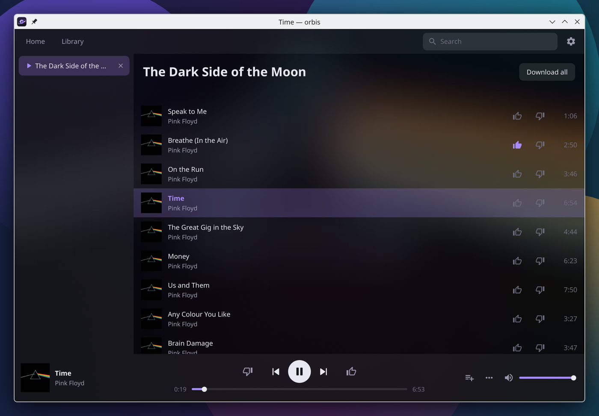
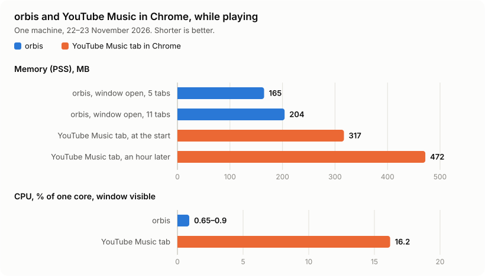

# orbis

A light YouTube Music player for the Linux desktop. The window is native
Qt Quick over a core in Rust: no web engine runs while you listen, so the
player does not slow down, grow in memory or drop frames over a long
session the way a browser tab does.



orbis is made for KDE Plasma on Wayland first; other desktops get the
player without the blur and with whatever tray they have.

> orbis is not affiliated with, endorsed by or connected to Google or
> YouTube. It talks to YouTube Music the way its web client does, with your
> own account. Use it in line with YouTube's Terms of Service and the law
> of your country, above all when downloading.

## Features

**Account**

- Sign in through a Google sign-in window of orbis's own (a web engine that
  lives only for the time of the sign-in), or take the sign-in of a browser
  where YouTube Music is open: Chrome, Chromium, Brave, Vivaldi or Firefox.
- The session is kept in the desktop's secret storage (KWallet or GNOME
  Keyring, through the Secret Service), never in a plain file.

**Listening**

- The home feed with its shelves, your library, playlists, albums, artists,
  and search with suggestions as you type.
- The personal mixes — Discover Mix, New Release Mix, My Supermix, Replay
  Mix — pinned as tabs; mixes and radios load more tracks as they play.
- Every tab has a queue of its own; tabs and queues come back after a
  restart.
- A radio from any track.
- Three stream qualities: best (Opus ~256 kbit/s with YouTube Music
  Premium), normal (~130–160 kbit/s) and economy (~50–70 kbit/s).
- Loudness normalization: tracks louder than YouTube's level (−14 LUFS)
  are turned down.
- Tracks you disliked can be skipped and hidden from playlists, mixes and
  radios.
- Like and dislike, add a track to a playlist or to a new one.

**Downloads**

- A track, an album or a whole playlist into your music folder.
- Opus (the stream as it is, without re-encoding), MP3 or M4A (AAC), with
  a bit rate of your choice.
- Tags: title, artists, album artist, album, year, track number, cover,
  lyrics, the track's link and its loudness gain; MusicBrainz adds its IDs,
  genres, the first release date and the disc number.
- File names from a template: `{album_artist} {artist} {album} {year}
  {track} {title}`, with `/` for folders.
- The download queue comes back after a restart.

**Desktop**

- A tray icon: closing the window hides it there, and the hidden window
  can be unloaded to free memory while the music goes on.
- MPRIS: media keys, the Plasma media player widget and KDE Connect.
- One instance: starting orbis again brings up the window.
- The blur of KWin behind the window, with the opacity of your choice.
- An English and a Ukrainian interface.

**Command line**

`orbis-cli` gives the same core without the window: sign-in, home, library,
playlists, albums, artists, search, radio, lyrics, ratings, playlist edits,
playback and downloads. `orbis-cli --help` lists them.

## How light it is



| While playing | Memory (PSS) | CPU |
|---|---|---|
| orbis, window open, 5 tabs | 165 MB | 0.65–0.9 % of one core |
| orbis, window open, 11 tabs | 204 MB | — |
| orbis, window hidden in the tray | 148–173 MB | 0.55 % |
| YouTube Music tab in Chrome, visible | 317 MB, 472 MB an hour later | 16.2 % |

Measured on one machine on 22–23 November 2026. Chrome played on the
desktop; orbis ran in a nested KWin with software rendering and its sound
sent nowhere (decoded in real time, not played). Memory is PSS, which does
not count shared pages twice. With the window open and paused, orbis draws
no frames at all. A track whose stream link is already known starts within
37–260 ms after "Next".

## Install

### AppImage

Release AppImages will appear on the
[Releases](https://github.com/gddrx/orbis/releases) page. They carry
everything orbis needs; the host gives only glibc, the graphics drivers and
the fonts.

### From source

Needed to build:

- Rust 1.89 or newer;
- Qt 6.12 with Qt Quick, Qt Quick Controls, Qt Wayland and Qt WebEngine
  (with their development files and `qmake6`);
- KDE Frameworks 6 KWindowSystem;
- libmpv (with its headers);
- a C++ compiler and `pkg-config`.

Needed to run: `yt-dlp` with Node.js (yt-dlp uses it for YouTube's player
challenges) and `ffmpeg` (for downloads), on the `PATH`.

```bash
cargo build --release
```

```bash
scripts/install.sh
```

`scripts/install.sh` installs `orbis` and `orbis-login` into `~/.local/bin`,
and the menu entry and icon into `~/.local/share`. `scripts/install.sh
--uninstall` removes them.

`scripts/appimage-release.sh` builds the AppImage of a release,
`orbis-<version>-x86_64.AppImage`, in a podman container on AlmaLinux 9:
Qt from qt.io, and FFmpeg, libmpv, libplacebo and KWindowSystem built from
source — FFmpeg and libmpv under the LGPL, audio only. It runs where glibc
is 2.34 or newer, and `orbis-<version>-THIRD-PARTY.md` beside it lists all
it carries. The versions and checksums of the sources are in
`scripts/release/versions.sh`.

`scripts/appimage.sh` is quicker: it builds an AppImage from the libraries
of the system it runs on. The result is named
`orbis-<version>-local-x86_64.AppImage`: it is meant for that machine and is
not for passing on, as it takes whatever FFmpeg the system has — some
distributions ship one that may not be redistributed.

## Where orbis keeps things

- `~/.config/orbis/config.toml` — the settings (also editable in the
  settings window);
- `~/.local/share/orbis/` — the tabs with their queues and the download
  queue;
- `~/.cache/orbis/` — covers and their blurred backdrops, stream links,
  MusicBrainz answers;
- the secret storage — the session.

Signing out in the settings window removes the session.

## Versions

orbis follows [Semantic Versioning](https://semver.org/); the changes of
each version are in [CHANGELOG.md](CHANGELOG.md). `orbis --version` and
the settings window show the version that runs.

## Built with

orbis stands on these projects. Those marked "in the AppImage" are shipped
inside it; the rest are linked into orbis's own binaries.

| Project | What orbis uses it for | License |
|---|---|---|
| [Qt 6](https://www.qt.io/) — Qt Quick, Qt Quick Controls, Qt Wayland | the window | LGPL-3.0 (in the AppImage) |
| [Qt WebEngine](https://doc.qt.io/qt-6/qtwebengine-index.html) | the Google sign-in window only | LGPL-3.0, with Chromium's licenses (BSD-3-Clause and others) (in the AppImage) |
| [Qt Bridge for Rust](https://code.qt.io/cgit/qt/qtbridge-rust.git/) | Rust objects and models in QML | LGPL-3.0-only |
| [KDE Frameworks KWindowSystem](https://invent.kde.org/frameworks/kwindowsystem) | the blur behind the window, focus from the tray | LGPL-2.1-or-later (in the AppImage) |
| [mpv](https://mpv.io/) (libmpv) | playback | GPL-2.0-or-later as built by most distributions; LGPL-2.1-or-later when built without its GPL parts (in the AppImage) |
| [FFmpeg](https://ffmpeg.org/) | decoding in libmpv; converting and measuring downloads | LGPL-2.1-or-later, or GPL when built with GPL parts (in the AppImage) |
| [yt-dlp](https://github.com/yt-dlp/yt-dlp) | the stream address of a track | Unlicense; its standalone build carries Python (PSF License) and its modules (in the AppImage) |
| [Node.js](https://nodejs.org/) | YouTube's player challenges, for yt-dlp | MIT (in the AppImage) |
| [SQLite](https://sqlite.org/) (through rusqlite) | tabs, queues, download queue, caches | public domain |
| [tokio](https://tokio.rs/), [reqwest](https://github.com/seanmonstar/reqwest), [serde](https://serde.rs/), [zbus](https://github.com/z-galaxy/zbus), [oo7](https://github.com/linux-credentials/oo7), [lofty](https://github.com/Serial-ATA/lofty-rs), [image](https://github.com/image-rs/image), [clap](https://github.com/clap-rs/clap) and the other Rust crates in `Cargo.lock` | networking, D-Bus, secret storage, tags, pictures, the command line | MIT, Apache-2.0 and similar permissive licenses |
| [Material Icons](https://fonts.google.com/icons) by Google | most icons of the window | Apache-2.0 |
| [linuxdeploy](https://github.com/linuxdeploy/linuxdeploy) and the [AppImage runtime](https://github.com/AppImage/type2-runtime) | building the AppImage | MIT |

Services orbis talks to:

- **YouTube Music** — the music, your library and your account.
- **[MusicBrainz](https://musicbrainz.org/)** — tags of downloads, when
  turned on in the settings. Its core data is in the public domain (CC0);
  genres are supplementary data under CC BY-NC-SA 3.0. The test fixtures in
  `crates/download/src/musicbrainz/fixtures/` are MusicBrainz answers under
  the same terms.

The license of each Rust crate is in its `Cargo.toml`; `cargo metadata`
lists them all.

## License

orbis is free software: you can redistribute it and/or modify it under the
terms of the GNU General Public License as published by the Free Software
Foundation, either version 3 of the License, or (at your option) any later
version. See [LICENSE](LICENSE).

In short: you may use, study, share and change orbis free of charge. Anyone
who passes orbis on — changed or not, for money or not — must pass on its
full source under the same license and keep the copyright notices; a
closed-source copy of orbis is not allowed.
